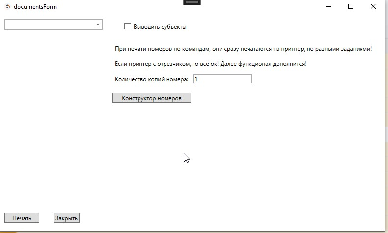
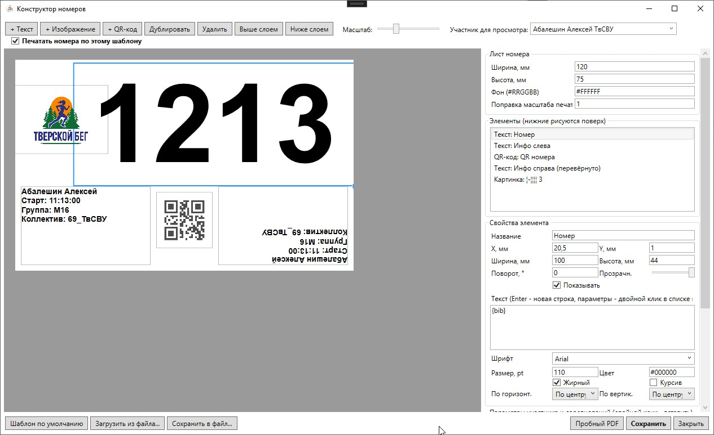

Конструктор номеров
===================

Конструктор позволяет настроить внешний вид нагрудного номера под свои соревнования: размер
номера, какие сведения об участнике выводить и где, свои картинки (логотипы, спонсоры, фон) и
QR-код с любым содержимым.

.. note::
   Сейчас конструктор работает в тестовом режиме: он включается галочкой, а без неё номера
   печатаются по-старому, по шаблону ``Templates/bib.html``.

Как открыть
-----------

Кнопка ``Печать`` на панели главного окна → окно документов → кнопка ``Конструктор номеров``.
Перед открытием выберите день: от него зависят дата соревнований и список участников для
просмотра.

Окно конструктора
-----------------

Слева находится сам номер в масштабе, справа настройки:

* **Лист номера**: ширина и высота в миллиметрах, цвет фона (``#RRGGBB``) и поправка масштаба
  печати (см. ниже);
* **Элементы**: всё, что размещено на номере. Элементы ниже в списке рисуются поверх верхних,
  порядок меняется кнопками ``Выше слоем`` / ``Ниже слоем``;
* **Свойства элемента**: положение, размер, поворот, прозрачность и настройки выбранного
  элемента;
* **Параметры участника и соревнований**: что можно подставить в текст или QR-код.

При первом открытии загружается стандартный шаблон 120×75 мм, повторяющий прежний номер:
крупный номер, сведения об участнике слева и они же перевёрнутые справа, QR-код посередине.
Кнопка ``Шаблон по умолчанию`` возвращает его в любой момент.

Над номером:

* ``+ Текст``, ``+ Изображение``, ``+ QR-код``: добавить элемент;
* ``Дублировать``, ``Удалить``;
* **Масштаб**: только для удобства на экране, на печать не влияет;
* **Участник для просмотра**: номер на экране показывается с данными выбранного участника
  дня. Если в дне ещё нет участников с номерами, показывается пример «Иванов Иван»;
* галочка **Печатать номера по этому шаблону**: включает новый номер для всей печати номеров.

Работа с элементами
-------------------

* Элемент перетаскивается мышью с шагом 0,5 мм. Размер меняется за синий квадрат в правом
  нижнем углу выбранного элемента.
* Стрелки на клавиатуре сдвигают элемент на 0,5 мм, со ``Shift`` на 5 мм. ``Delete`` удаляет
  элемент.
* Точные значения X, Y, ширины и высоты (в мм) вводятся в свойствах элемента.
* **Поворот** задаётся в градусах вокруг центра элемента. 180° даёт перевёрнутую надпись,
  которую удобно читать, когда номер приколот на груди.
* **Показывать**: временно скрыть элемент, не удаляя его.

.. image:: ../screens/bib_designer_props.jpg

Текст
~~~~~

Текст можно писать в несколько строк (``Enter``) и вставлять в него параметры. Для текста
настраиваются шрифт, размер в пунктах (pt), цвет, жирный и курсив, выравнивание по горизонтали
и по вертикали.

Изображение
~~~~~~~~~~~

``Загрузить картинку...`` (png, jpg, bmp, gif). Картинка сохраняется прямо в шаблоне, поэтому
исходный файл потом не нужен. Способ вписывания:

* **Вписать с пропорциями**: картинка целиком, без искажений;
* **Заполнить с обрезкой**: заполняет весь элемент, лишнее обрезается;
* **Растянуть**: точно по размеру элемента, пропорции могут исказиться.

Картинку на весь лист с низкой прозрачностью можно использовать как фон номера.

QR-код
~~~~~~

QR-код создаётся для каждого участника отдельно. По умолчанию в нём ``{bibRaw}``, то есть
номер участника. Содержимое можно собрать из любых параметров, например
``{bibRaw};{surname};{group}``.

Параметры
---------

Параметры пишутся в фигурных скобках и при печати заменяются данными участника. Двойной клик
по параметру в списке вставляет его в текст или QR-код выбранного элемента. Если параметр
написан с ошибкой, он печатается как есть: так опечатку сразу видно.

.. list-table::
   :header-rows: 1
   :widths: 30 70

   * - Параметр
     - Что подставляется
   * - ``{bib}``
     - Номер. Для эстафеты в виде «команда.этап»
   * - ``{bibRaw}``
     - Номер как в базе
   * - ``{surname}``, ``{name}``, ``{fatherName}``
     - Фамилия, имя, отчество
   * - ``{fullName}``
     - Фамилия и имя
   * - ``{year}``, ``{birthDate}``
     - Год рождения, полная дата рождения
   * - ``{qualification}``
     - Разряд
   * - ``{group}``
     - Группа
   * - ``{team}``, ``{teamCode}``, ``{region}``
     - Коллектив, код коллектива, субъект
   * - ``{start}``, ``{startShort}``
     - Время старта ЧЧ:ММ:СС и ЧЧ:ММ
   * - ``{chip}``
     - Номер чипа
   * - ``{relayTeam}``, ``{relayStage}``
     - Эстафетная команда и этап
   * - ``{comment}``
     - Комментарий участника
   * - ``{compName}``
     - Название соревнований
   * - ``{compDate}``, ``{compTime}``
     - Дата и время начала выбранного дня
   * - ``{place}``, ``{discipline}``, ``{organizers}``
     - Место проведения, дисциплина, организаторы
   * - ``{day}``
     - Номер дня

Данные соревнований берутся из ``Настройки -> Информация`` (см. :doc:`competition`).

Пробный PDF и поправка масштаба
-------------------------------

``Пробный PDF`` собирает номер выбранного участника в PDF так же, как при печати, и открывает
его. Так удобно проверить результат, не расходуя бумагу.

.. image:: ../screens/bib_designer_pdf.jpg

Если на бумаге номер получается крупнее или мельче заданного размера, подберите **Поправку
масштаба печати** в настройках листа (например 0,75 или 1,33) и снова проверьте пробный PDF.

Номер, у которого ширина больше высоты, печатается в альбомной ориентации, иначе в книжной.

Сохранение и перенос шаблона
----------------------------

* ``Сохранить``: шаблон и галочка «Печатать номера по этому шаблону» сохраняются в файле
  соревнования. При закрытии с несохранёнными изменениями программа спросит, сохранить ли их.
* ``Сохранить в файл...`` / ``Загрузить из файла...``: шаблон в файле ``.bibtpl``, чтобы
  перенести его в другое соревнование или на другой компьютер.

Где применяется
---------------

Когда галочка **Печатать номера по этому шаблону** включена и шаблон сохранён, по нему
печатаются:

* номера при регистрации на старте (галочка ``Печатать номера``, см. :doc:`start`);
* **Распечатать номера по командам** в окне документов, с учётом «Количества копий номера».

Если снять галочку, снова используется прежний номер.
