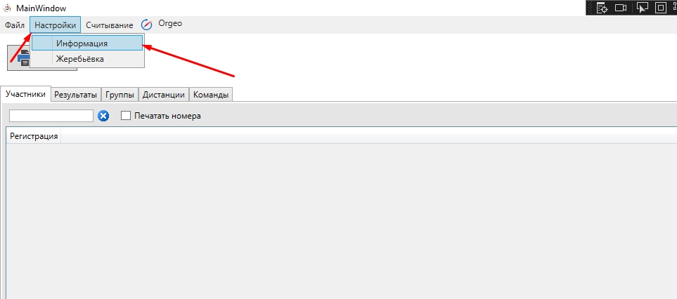
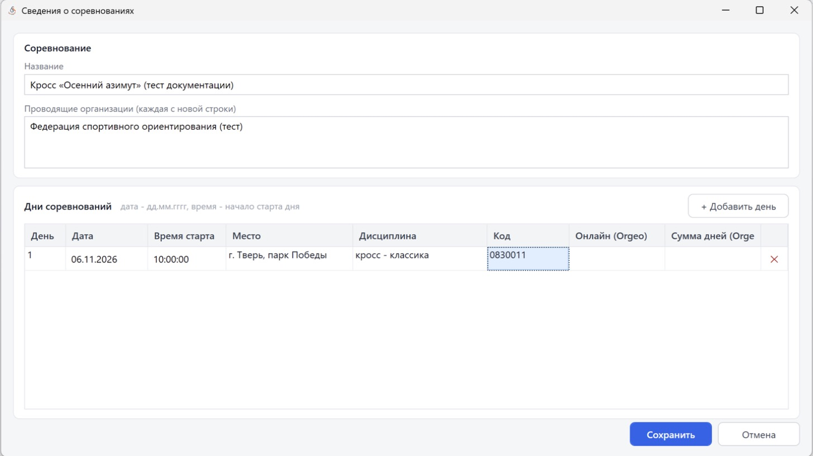
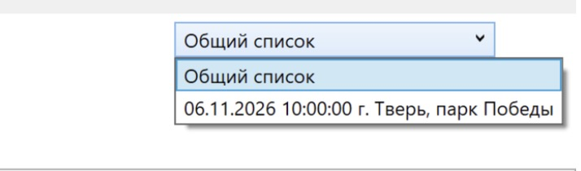

Создание соревнований
=====================

Создание файла
--------------

1. Запускаем программу — ``BelovSportProgram``.

   .. image:: ../screens/start.jpg

2. Через меню ``Файл -> Создать`` создаём новый файл соревнований (``*.bsp``) или открываем
   существующий через ``Файл -> Открыть``.

   .. image:: ../screens/create.jpg

Сведения о соревнованиях
------------------------

Меню ``Настройки -> Информация`` открывает окно **«Сведения о соревнованиях»**.

В окне заполняются:

* **Название** соревнований;
* **Проводящие организации** — каждая с новой строки (выводятся в шапке протоколов);
* таблица **Дни соревнований** — по строке на каждый соревновательный день.

.. list-table:: Колонки таблицы дней
   :header-rows: 1
   :widths: 25 75

   * - Колонка
     - Что вводить
   * - День
     - Номер дня (1, 2, …)
   * - Дата
     - Дата в формате **дд.мм.гггг**
   * - Время старта
     - Время начала старта дня в формате **ЧЧ:ММ:СС**. Это время подставляется в жеребьёвку
       как время первого старта (в форме жеребьёвки его можно изменить)
   * - Место
     - Место проведения
   * - Дисциплина
     - Название дисциплины (например, «кросс-классика»)
   * - Код
     - Код дисциплины по ВРВС
   * - Онлайн (Orgeo)
     - Ссылка для отправки данных на orgeo.ru (см. :doc:`orgeo`)
   * - Сумма дней (Orgeo)
     - Ссылка для отправки суммы дней на orgeo.ru

* Кнопка ``+ Добавить день`` добавляет новый день.
* Кнопка ``Удалить день (только последний)`` удаляет последний день. Удалить можно только
  последний день и только если в нём ещё нет стартового протокола, результатов и дистанций —
  номера дней используются в стартовых протоколах и результатах. День удаляется при сохранении.

.. attention::
   | Дата — **дд.мм.гггг**, время — **ЧЧ:ММ:СС**. В старых версиях дата вводилась как мм/дд/гггг.
   | Лучше указывать время старта первого участника (например, 10:01:00).

Выбор соревновательного дня
---------------------------

Почти все действия (импорт дистанций, жеребьёвка, регистрация, результаты, печать) выполняются
для **выбранного соревновательного дня** — он выбирается в выпадающем списке главного окна.
Если день не выбран, программа выдаст сообщение «Не выбран стартовый день!».

Главное окно
------------

Главное окно состоит из меню и вкладок:

.. list-table::
   :header-rows: 1
   :widths: 25 75

   * - Вкладка
     - Назначение
   * - Участники
     - Поиск, регистрация, печать номеров, редактирование участников (см. :doc:`start`)
   * - Результаты
     - Результаты выбранного дня, «в лесу», отметки, сплиты (см. :doc:`results`)
   * - RFID
     - Считывание UHF-меток, ручные отсечки, отклонённые считки (см. :doc:`results`)
   * - Группы, Дистанции, Команды
     - Справочники соревнований (см. :doc:`groups`)
   * - Сервис
     - Количество участников, командные результаты и вспомогательные функции
       (см. :doc:`documents`)

Мандатная комиссия (:doc:`mandatka`) и награждение (:doc:`documents`) открываются в отдельных
окнах.

.. list-table:: Меню
   :header-rows: 1
   :widths: 25 75

   * - Меню
     - Пункты
   * - Файл
     - Создать, Открыть, Импорт (Участники (CSV), Дистанции версии OCAD8 (текст)),
       Сформировать официальные протоколы
   * - Настройки
     - Настройки программы, Информация, Упрощённая регистрация, Присваивать номер чипа при
       регистрации
   * - Подготовка к старту
     - Мандатная комиссия, Жеребьёвка, Жеребьёвка (новая форма), Подставить дистанции в группы,
       Массовое изменение групп, Ввод забегов, Ввод эстафетных команд, Заменить номера ЧИПов
       нагрудными номерами
   * - Исправление
     - Корректировка старта, Перепроверить результаты, Свернуть отсечки (rfid) в один результат
   * - Считывание
     - SFR, Chafon CF810, RFID: отправить очередь сейчас, RFID: сохранить журнал этого компьютера,
       RFID: загрузить журнал другого компьютера
   * - Orgeo
     - Отправить стартовый протокол, Отправить не стартовавших, Отправить результаты
