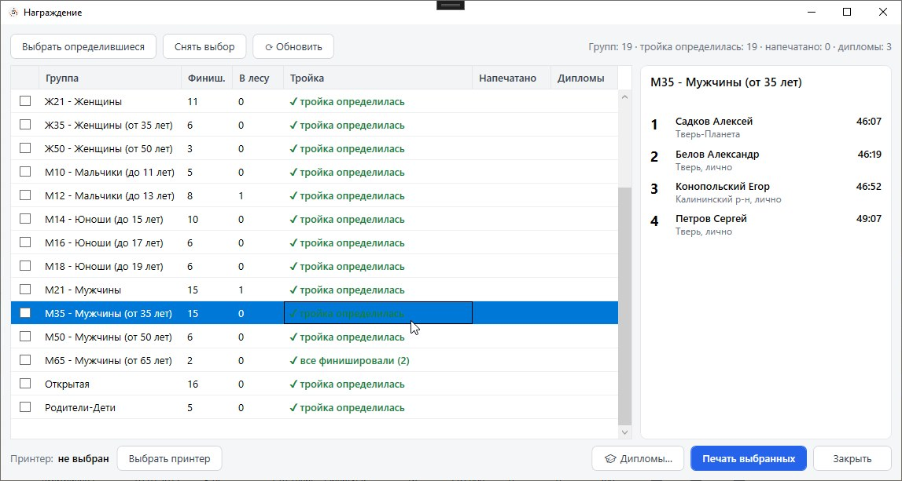

Дипломы
=======

Программа готовит дипломы призёрам по шаблону Word (``.docx``): на каждого призёра
выбранных групп одна страница, все дипломы собираются в один документ, который сразу
открывается в Word. Печатать дальше можно прямо из Word на любой принтер.

Как открыть
-----------

Кнопка ``🏆 Награждение`` на панели главного окна → отметьте галочками группы (или нажмите
``Выбрать определившиеся``) → кнопка ``🎓 Дипломы…``.

Если в какой-то из отмеченных групп тройка ещё не определилась, программа переспросит,
делать ли дипломы всё равно. После формирования у группы в колонке **Дипломы** появляется
время. Как и «Напечатано», эта отметка хранится до закрытия программы.

Окно «Дипломы»
--------------

* **Шаблон** — какой шаблон используется сейчас:

  * ``Загрузить…`` — выбрать свой ``.docx``. Он сохраняется в файле соревнования, поэтому
    переезжает вместе с ним на другой компьютер. При загрузке программа показывает, какие
    метки нашла в шаблоне;
  * ``Сохранить копию…`` — сохранить текущий шаблон в файл, чтобы поправить его в Word и
    загрузить обратно;
  * ``Сбросить`` — вернуться к встроенному шаблону ``Templates/диплом.docx``.

* **Места с 1 по N** — по умолчанию с 1-го по 3-е. При дележе места диплом получают все
  разделившие его.
* **Группа на дипломе** — короткое название (``Ж16``) или официальное
  (``Женщины до 17 лет``). Если официального нет, берётся короткое.
* **Фон шаблона** — снимите галочку для печати на готовых типографских бланках (см. ниже).
* **Печать и подпись** — снимите, если диплом будет подписываться и заверяться вручную.
* Таблица групп: Группа, Официальное название, **в …** и **Дипломов** (сколько дипломов
  получится в группе при выбранных местах).

Колонка «в …»
~~~~~~~~~~~~~

В шаблоне строка выглядит так: «в *<НазваниеСоревнований>* по спортивному ориентированию».
Колонка **в …** — это то, что подставится вместо метки, уже в нужном падеже:
«Первенстве г. Твери» или «Чемпионате г. Твери». Значение задаётся **для каждой группы**,
потому что в одних соревнованиях часть групп может идти по Чемпионату, а часть по Первенству.

* По умолчанию подставляется название дня из настроек соревнований, его нужно поправить один
  раз: программа запоминает значение для группы в файле соревнования.
* Чтобы заполнить сразу несколько групп, выделите строки (Ctrl / Shift + клик), впишите текст
  в поле **«в …»** над таблицей (там же выпадающий список уже использованных вариантов) и
  нажмите ``Применить к выделенным``.

Сформировать
~~~~~~~~~~~~

``Сформировать и открыть в Word`` спрашивает, куда сохранить файл (по умолчанию
``Дипломы ДД.ММ.ГГГГ.docx``), собирает дипломы и открывает документ в Word. Если файл с тем же
именем уже открыт в Word, программа сообщит об ошибке: закройте его или сохраните под другим
именем. Все настройки окна запоминаются для следующего раза.

Печать на готовых бланках
-------------------------

Без галочки **Фон шаблона** из дипломов убираются картинки, помеченные как фон, и всё
содержимое колонтитулов (во встроенном шаблоне это узор с логотипом сверху и горы с адресом
сайта снизу). Текст при этом остаётся на тех же местах, что и в шаблоне, поэтому его можно
печатать прямо на бланк. Если надписи не попадают в поля бланка, подвиньте их в шаблоне
(``Сохранить копию…`` → правка в Word → ``Загрузить…``).

Свой шаблон
-----------

Шаблон — обычный документ Word. В нужные места впишите метки в угловых скобках, например
``<Фамилия> <Имя>``. Метки можно оформлять как угодно (шрифт, размер, цвет), в том числе
внутри надписей (текстовых полей). Неизвестные программе метки остаются как есть.

.. list-table::
   :header-rows: 1
   :widths: 35 65

   * - Метка
     - Что подставляется
   * - ``<Фамилия>``, ``<Имя>``, ``<ФИО>``
     - фамилия, имя, «Фамилия Имя»
   * - ``<Место>``, ``<МестоРим>``
     - место цифрами (3) или римскими (III)
   * - ``<Группа>``
     - короткое или официальное название группы (переключатель в окне)
   * - ``<Команда>``, ``<Результат>``
     - коллектив и результат (``25:14`` или ``1:02:30``)
   * - ``<НазваниеСоревнований>``
     - значение колонки «в …» для группы
   * - ``<Дисциплина>``, ``<МестоПроведения>``, ``<Организаторы>``
     - из настроек дня соревнований
   * - ``<Дата>``, ``<ДатаЦифрами>``
     - «08 ноября 2026» или «08.11.2026»

Картинки, которые нужно убирать по галочкам, помечаются через **Замещающий текст**
(правый клик по картинке в Word → «Изменить замещающий текст»):

* ``фон`` — убирается без галочки **Фон шаблона**;
* ``печать``, ``подпись`` — убираются без галочки **Печать и подпись**.

Колонтитулы целиком считаются фоном. Картинки «за текстом» или «перед текстом» удаляются,
а картинки с обтеканием становятся прозрачными, чтобы текст не сдвинулся.

Каждый диплом в документе — отдельный раздел с копией шаблона, поэтому шаблон должен
умещаться на одну страницу. Если длинная фамилия или название переносится на новую строку и
диплом расползается на две страницы, уменьшите в шаблоне шрифт или интервалы.
