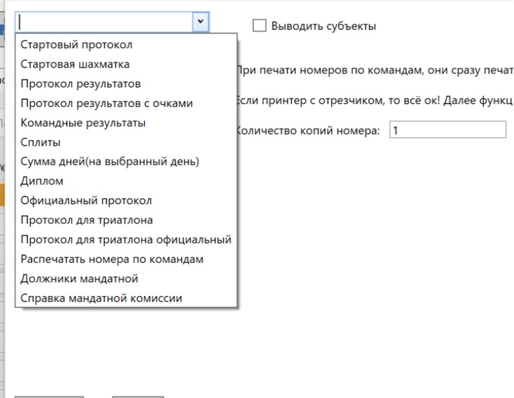
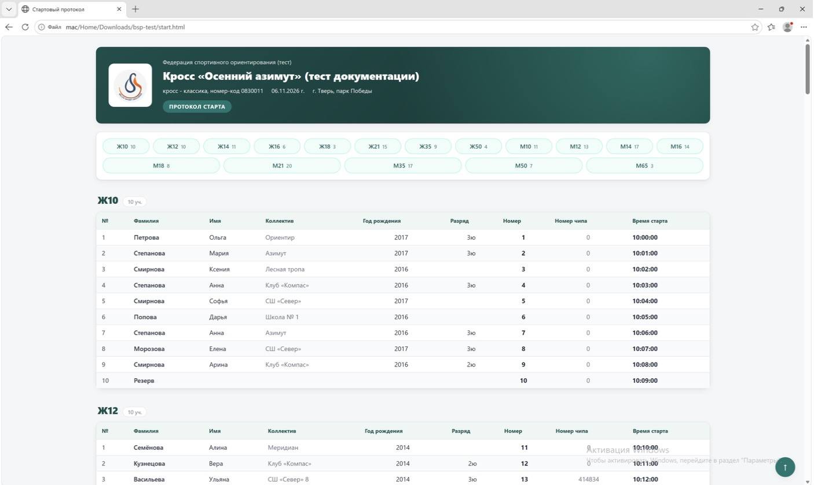
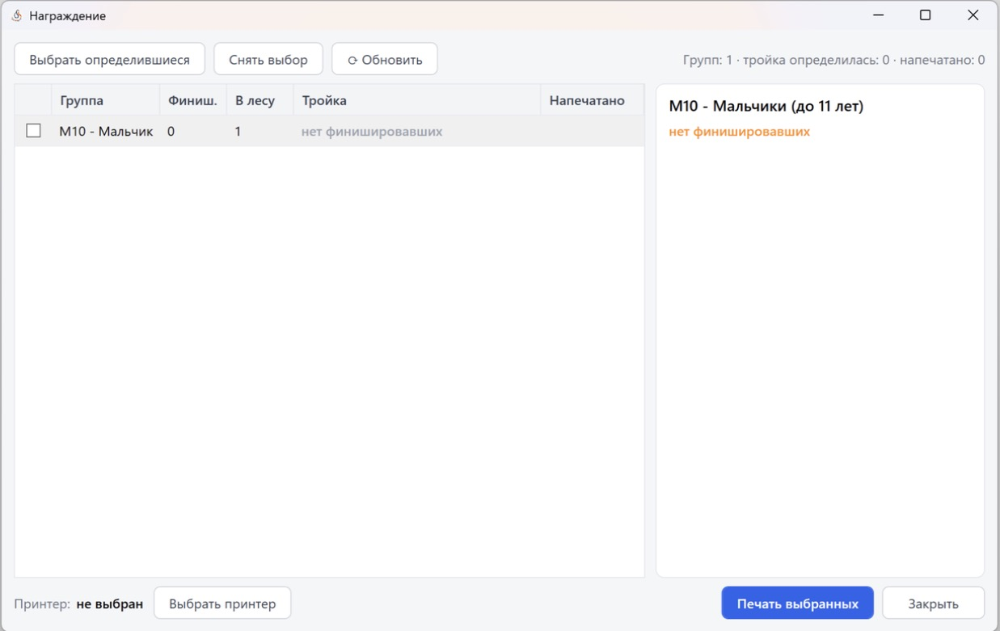
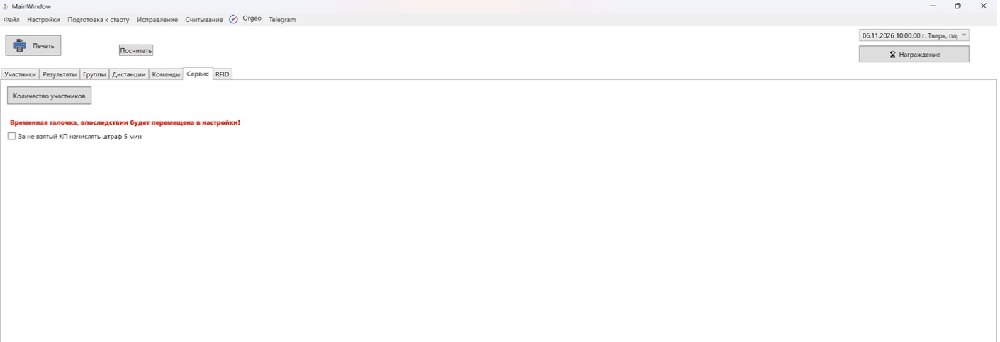

Документы, сплиты и награждение
===============================

Печать документов
-----------------

Кнопка ``Печать`` на панели главного окна открывает окно документов. Выберите тип документа
в выпадающем списке и нажмите ``Печать``. Документ формируется в HTML для выбранного дня:
программа спросит, куда сохранить файл (например, ``start.html``), и откроет его в браузере —
оттуда его можно распечатать.

В этом же окне есть:

* галочка **Выводить субъекты** — вместо команды выводится субъект РФ в документах «Стартовый
  протокол», «Протокол результатов», «Сплиты», «Официальный протокол» и «Справка мандатной
  комиссии» (на номера не влияет);
* **Количество копий номера** — действует только для «Распечатать номера по командам».

Если день не выбран, в списке доступны только «Должники мандатной» и «Справка мандатной
комиссии».

.. list-table:: Доступные документы
   :header-rows: 1
   :widths: 35 65

   * - Документ
     - Описание
   * - Стартовый протокол
     - По группам, с номерами и временем старта
   * - Стартовая шахматка
     - По строке на каждое время старта с номерами всех, кто стартует в это время — для
       стартовой команды
   * - Протокол результатов
     - Места, результаты, отставание; для эстафет — по командам и этапам
   * - Сплиты
     - Сплиты всех участников по группам
   * - Сумма дней(на выбранный день)
     - Сумма результатов всех дней по выбранный включительно (колонки «День 1…N»). Для
       первого дня недоступна: «Формирование суммы недоступно для первого дня!»
   * - Протокол для триатлона, Протокол для триатлона официальный
     - Результаты по этапам (названия этапов задаются в дистанции)
   * - Командные результаты
     - Подсчёт командного зачёта (см. ниже)
   * - Официальный протокол
     - Протокол результатов дня с полным ФИО и датой рождения (дд.мм.гггг). Протоколы по ЕВСК
       с разрядами делаются отдельно, см. :doc:`official`
   * - Распечатать номера по командам
     - Печать номеров на принтер, по команде на задание (удобно для принтера с отрезчиком)
   * - Должники мандатной, Справка мандатной комиссии
     - См. :doc:`mandatka`

.. warning::
   В текущей сборке пункты «Диплом» и «Протокол результатов с очками» есть в списке, но ничего
   не формируют. «Распечатать номера по командам» отмечает всех участников дня как
   зарегистрированных, после чего завершается ошибкой.

Оформление протоколов
~~~~~~~~~~~~~~~~~~~~~

В ``Настройки -> Настройки программы`` на вкладке **Документы** задаются:

* **Стиль оформления протоколов**: Изумруд, Оранжевый, Синий с оранжевым, Синий, Бордо,
  Фиолетовый, Строгий;
* **Порядок групп в протоколах**: по названию, по возрасту, в порядке создания;
* **Логотипы спонсоров над шапкой протоколов** — папка с логотипами на этом компьютере
  (по умолчанию ``%APPDATA%\BelovSportProgram\SponsorLogos``).
  Берутся все файлы png, jpg, jpeg, gif, webp, svg из папки в порядке имён (``01_…``,
  ``02_…``). Галочка сохраняется в файле соревнования, папка — на этом компьютере.

Оформление применяется к стартовому протоколу, протоколу результатов, сплитам, сумме дней,
протоколам для триатлона и официальным протоколам. «По возрасту» — по первому числу в названии
группы.

Сплит участника
---------------

Сплит печатается после считки (галочка ``Печать распечаток``) или пунктом контекстного меню
``Печать сплита`` (**F2**) на вкладке «Результаты». На сплите:

* шапка: название, место, дисциплина, дата;
* группа, команда, номер, время старта;
* перегоны и общее время по КП, темп (мин/км), лучший перегон и отставание;
* не взятые («НЕ ВЗЯТ») и лишние («лишняя») КП, итог «Отметка: ОК» или «Отметка: ПЛОХАЯ» со
  списком «Не взяты: …»;
* результат, «Место: N из M» и «Вас уже никто не обгонит!» или «Вас могут обогнать N чел.»;
* «Предварительные результаты» группы (первые 10);
* напоминание сдать арендованный чип, если чип арендный.

У эстафет место и предварительные результаты не выводятся.

Сплит формируется как чек шириной 72 мм (PDF) и печатается через SumatraPDF на выбранный
принтер — чековый или обычный.

Награждение
-----------

Кнопка ``🏆 Награждение`` на панели главного окна открывает окно, которое помогает печатать
призёров по мере финиша групп. В списке — группы, где есть финишировавшие или кто-то ещё в
лесу; список обновляется сам раз в 30 секунд.

* Таблица групп: Группа, Финиш. (финишировали), В лесу, Тройка (определилась ли тройка),
  Напечатано.
* ``Выбрать определившиеся`` — выбрать группы, где тройка определилась и награждение ещё не
  печаталось. ``Снять выбор``, ``⟳ Обновить``, ``Закрыть``.
* Справа показывается тройка выбранной группы.
* Нажмите ``Выбрать принтер``, затем ``Печать выбранных``. Все выбранные группы печатаются
  одним чеком, на нём места с 1-го по 4-е.
* Отметка «Напечатано» хранится только до закрытия программы.

Если тройка ещё не определилась (кто-то в лесу может обогнать), программа предложит напечатать
предварительно — с пометкой «ПРЕДВАРИТЕЛЬНО: могут обогнать N» на чеке.

Командные результаты
--------------------

Документ **Командные результаты** в окне документов: отметьте галочками группы для подсчёта,
выберите **параметры подсчёта** (по времени или по очкам) и **количество в зачёт** (сколько
лучших результатов команды учитывается), нажмите ``Сформировать``. Очки за места: 40, 37, 35,
33, 32, 31, 30 и далее на 1 меньше до 1. Участники «Лично» не учитываются, снятые получают 0
очков.

Вкладка «Сервис»
----------------

* ``Количество участников`` — таблица «группы × День 1…N» с итоговой строкой. Считаются все
  заявленные по дням участия, регистрация на старте не учитывается.
* Галочка **За не взятый КП начислять штраф 5 мин** (временная, потом переедет в настройки).
