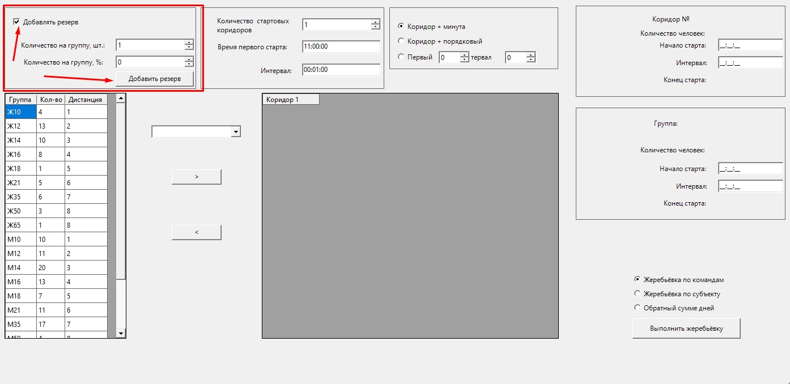
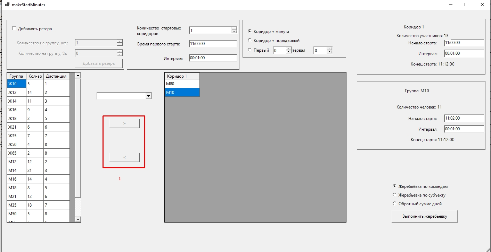

Жеребьёвка
==========

Перед жеребьёвкой выберите соревновательный день и проверьте, что у групп заданы дистанции.

В программе две формы жеребьёвки:

* ``Подготовка к старту -> Жеребьёвка (новая форма)`` — основная, описана ниже;
* ``Подготовка к старту -> Жеребьёвка`` — прежняя форма (см. в конце раздела).

Новая форма жеребьёвки
----------------------

Общие параметры
~~~~~~~~~~~~~~~

* **Первый старт** — время первого старта (подставляется из «Сведений о соревнованиях»).
* **Интервал** — общий стартовый интервал.
* **Стартовых коридоров** — количество коридоров. Кнопка ``Убрать последний (пустой) коридор``.

Тип жеребьёвки
~~~~~~~~~~~~~~

* **По командам (одноклубники не подряд)** — случайный порядок, одноклубники разводятся. Если
  развести полностью не удалось, программа покажет, где одноклубники стартуют подряд.
* **Обратный прошлому дню** — порядок, обратный результатам прошлого дня. Недоступна в первый
  день.
* **По субъекту** — пока не поддерживается.
* **Обратный сумме дней** — пока не поддерживается.

Номера
~~~~~~

* **Коридор + минута старта (по общему интервалу)** — номер вида «коридор и минута»: из него
  видно, в каком коридоре и на какой минуте стартует участник.
* **Коридор + по порядку** — номера в коридоре идут подряд.
* **Подряд с номера … шаг …** — сквозная нумерация с заданного номера и с заданным шагом.

У каждой группы можно задать своё поле **Номера с** — с какого номера нумеровать группу.

Резерв
~~~~~~

Задайте количество резервных мест **шт. на группу** или **%**, и нажмите ``Добавить резерв``.
Берётся большее из двух значений; резерв добавляется только в группы с участниками.

Резервные места — это участники с фамилией «Резерв»: у них есть номер и время старта, их
можно отдать заявившимся на месте.

Распределение групп по коридорам
~~~~~~~~~~~~~~~~~~~~~~~~~~~~~~~~

* Слева — список **Группы вне коридоров**. Двойной клик или кнопка ``В коридор →`` переносит
  группу в выбранный коридор.
* Для выбранного **коридора** можно задать начало старта и интервал и нажать
  ``Применить ко всему коридору`` — все группы коридора получат этот интервал и встанут друг
  за другом.
* Для выбранной **группы** задаются начало старта, интервал и «Номера с». Кнопка ``Применить``
  сохраняет параметры, следующие группы коридора сдвигаются следом.
* ``← Убрать из коридора (Delete)`` — вернуть группу в список вне коридоров.
* Группы, которые начинают старт раньше, чем закончится старт предыдущей группы,
  подсвечиваются.

Выполнение
~~~~~~~~~~

Нажмите ``Выполнить жеребьёвку``. Перед выполнением программа покажет предупреждения:

* стартовый протокол дня будет заменён;
* сбросятся отметки регистрации и оплаты на этот день;
* группы не в коридорах не получат старт и номер;
* группы, которые пересекаются по времени с предыдущей группой.

После подтверждения формируется стартовый протокол дня: номера и время старта.

Прежняя форма жеребьёвки
------------------------

``Подготовка к старту -> Жеребьёвка``.

.. image:: ../screens/jereb.jpg

1. Добавление резерва: поставьте галочку ``Добавлять резерв``, задайте количество (шт. или % на
   группу) и нажмите ``Добавить резерв``. При одновременном использовании двух параметров
   используется максимальное значение.
2. Кнопками переносите группы на доску планирования (коридоры).
3. На панели справа меняйте стартовый интервал и время начала старта для группы и для коридора.
4. Выберите тип нумерации: ``Коридор + порядковый``, ``Коридор + интервал (глобальный)``.
5. Нажмите ``Выполнить жеребьёвку``.

Корректировка старта
--------------------

``Исправление -> Корректировка старта`` — сдвиг стартового времени (например, при задержке
старта). Выберите группы (``Все`` / ``Убрать все``), задайте время и нажмите ``Добавить`` или
``Отнять`` — время старта выбранных групп сдвинется на заданную величину.
