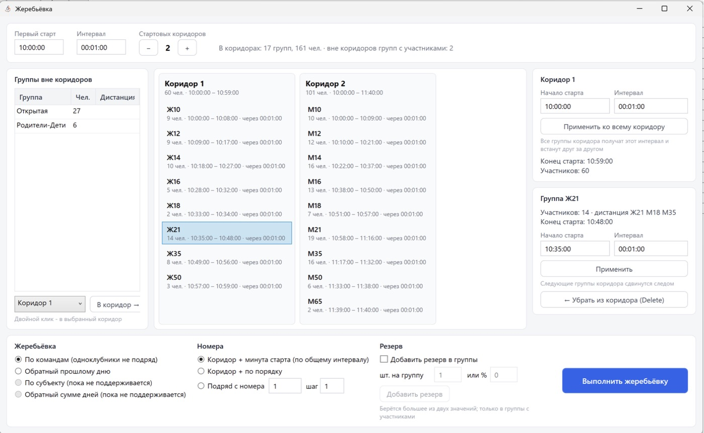
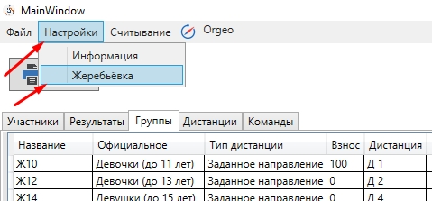

Жеребьёвка
==========

Перед жеребьёвкой выберите соревновательный день и проверьте, что у групп заданы дистанции.

В программе две формы жеребьёвки:

* ``Подготовка к старту -> Жеребьёвка (новая форма)`` — основная, описана ниже;
* ``Подготовка к старту -> Жеребьёвка`` — прежняя форма (см. в конце раздела).

Новая форма жеребьёвки
----------------------

Общие параметры
~~~~~~~~~~~~~~~

* **Первый старт** — время первого старта (подставляется из «Сведений о соревнованиях»).
* **Интервал** — общий стартовый интервал (по умолчанию 00:01:00).
* **Стартовых коридоров** — количество коридоров: кнопка ``+`` добавляет коридор, ``−``
  убирает последний (пустой) коридор.

Тип жеребьёвки (блок «Жеребьёвка»)
~~~~~~~~~~~~~~~~~~~~~~~~~~~~~~~~~~

* **По командам (одноклубники не подряд)** — случайный порядок, одноклубники разводятся.
  Учитываются забеги (см. «Ввод забегов» в :doc:`groups`). Участников без команды, команды со
  словом «лично» в названии и резервы не разводятся. Если развести полностью не удалось,
  программа покажет, где одноклубники стартуют подряд.
* **Обратный прошлому дню** — первыми стартуют участники без результата и снятые, лучшие —
  последними, при равном результате порядок случайный. Недоступна в первый день.
* **По субъекту (пока не поддерживается)**.
* **Обратный сумме дней (пока не поддерживается)**.

Номера
~~~~~~

* **Коридор + минута старта (по общему интервалу)** — номер вида «коридор и минута»: из него
  видно, в каком коридоре и на какой минуте стартует участник.
* **Коридор + по порядку** — номера в коридоре идут подряд.
* **Подряд с номера … шаг …** — сквозная нумерация с заданного номера и с заданным шагом.
  В этом режиме у группы появляется поле **Номера с** — свой начальный номер группы.

Пример для «Коридор + минута старта»: номер = (коридор − 1) × 100 + номер стартовой минуты от
первого старта (первая минута — 1). Если первый старт в 10:00, участник 1-го коридора со
стартом в 10:00 получит номер 1, а участник 2-го коридора со стартом в 10:05 — номер 106.
Если номера коридора выходят за сотню, следующий коридор начинается со следующей свободной
сотни.

Резерв
~~~~~~

Поставьте галочку **Добавить резерв в группы**, задайте количество мест **шт. на группу** или
**%** и нажмите
``Добавить резерв``. Программа спросит подтверждение, например «Добавить 19 резервных мест в
19 групп с участниками?». Берётся большее из двух значений; резерв добавляется во все группы с
участниками, в том числе в те, что ещё не распределены по коридорам.

Резервные места — это участники с фамилией «Резерв» (без команды, участвуют только в текущем
дне): у них есть номер и время старта, их можно отдать заявившимся на месте.

Распределение групп по коридорам
~~~~~~~~~~~~~~~~~~~~~~~~~~~~~~~~

* Слева — список **Группы вне коридоров**. Двойной клик или кнопка ``В коридор →`` переносит
  группу в выбранный коридор.
* Для выбранного **коридора** можно задать начало старта и интервал и нажать
  ``Применить ко всему коридору`` — все группы коридора получат этот интервал и встанут друг
  за другом.
* Для выбранной **группы** задаются начало старта и интервал. Кнопка ``Применить``
  сохраняет параметры, следующие группы коридора сдвигаются следом. Если старт группы
  раньше, чем закончится старт предыдущей группы, программа откажет с сообщением.
* ``← Убрать из коридора (Delete)`` — вернуть группу в список вне коридоров.
* Группы, которые начинают старт раньше, чем закончится старт предыдущей группы,
  подсвечиваются.

Выполнение
~~~~~~~~~~

Нажмите ``Выполнить жеребьёвку``. Перед выполнением программа покажет предупреждения:

* стартовый протокол дня будет заменён;
* сбросятся отметки регистрации и оплаты на этот день;
* группы не в коридорах (с их списком) не получат старт и номер;
* группы, которые пересекаются по времени с предыдущей группой.

После подтверждения формируется стартовый протокол дня: номера и время старта.

Прежняя форма жеребьёвки
------------------------

``Подготовка к старту -> Жеребьёвка``.

1. Добавление резерва: поставьте галочку ``Добавлять резерв``, задайте «Количество на группу,
   шт.:» или «Количество на группу, %:» и нажмите ``Добавить резерв``. При одновременном
   использовании двух параметров используется максимальное значение.
2. Кнопками ``>`` и ``<`` переносите группы на доску планирования (коридоры).
3. На панели справа меняйте стартовый интервал и время начала старта для группы и для коридора.
4. Выберите тип жеребьёвки: «Жеребьёвка по командам», «Обратный прошлому дню», «Обратный сумме
   дней», «Жеребьёвка по субъекту».
5. Выберите тип нумерации: ``Коридор + порядковый``, ``Коридор + интервал(глобальный)`` или
   ``Первый … интервал``.
6. Нажмите ``Выполнить жеребьёвку``.

Корректировка старта
--------------------

``Исправление -> Корректировка старта``. Отметьте группы галочками в колонке «Изменить время»
(``Все`` / ``Убрать все``) и выберите режим:

* **Задержка старта** — задайте время, выберите ``Добавить`` или ``Отнять`` и нажмите
  ``Изменить время``: старт выбранных групп сдвинется на заданную величину;
* **Присвоение стартового времени** — всем участникам выбранных групп ставится одно время
  старта (масс-старт), результаты пересчитываются.

.. warning::
   В текущей сборке «Задержка старта» сдвигает старт выбранных групп **во всех днях**, а не
   только в выбранном, и уже записанные результаты не пересчитывает.
