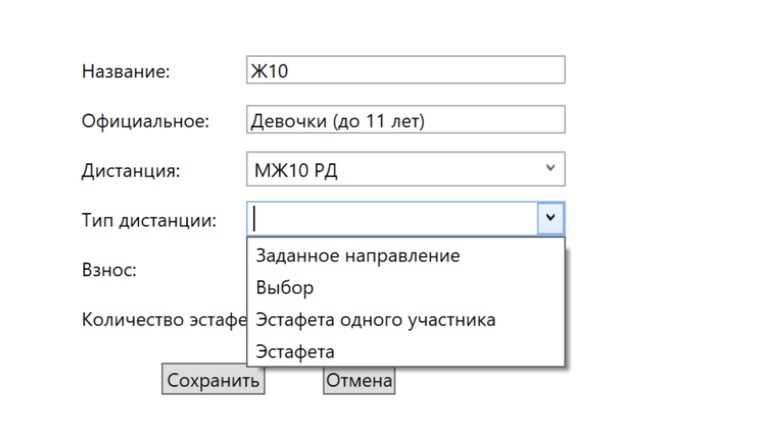
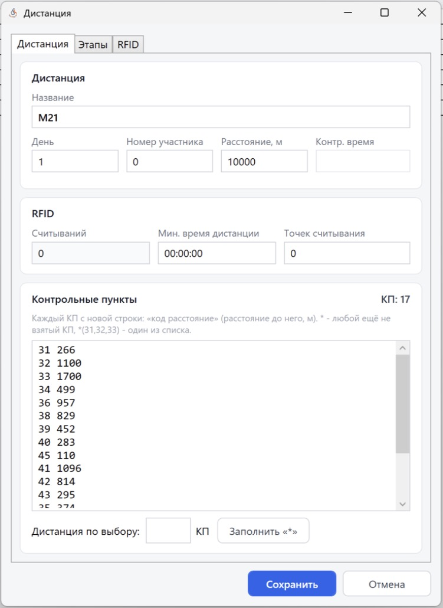

Группы, дистанции, команды
==========================

Справочники находятся на одноимённых вкладках главного окна. Запись открывается двойным
кликом. Добавить или удалить запись можно через контекстное меню (правая кнопка мыши по
таблице): ``Создать группу`` / ``Удалить группу`` и т.п.

Удалить группу, дистанцию или команду нельзя, если на неё ссылаются участники или группы —
программа об этом предупредит.

Группа
------

.. warning::
   Параметры группы (дистанция, тип, взнос, эстафетные этапы) задаются **на выбранный день**.
   Если день не выбран, программа предупредит, что дистанция и взнос не сохранятся.

.. list-table::
   :header-rows: 1
   :widths: 30 70

   * - Поле
     - Описание
   * - Название
     - Короткое название группы (М21, Ж14)
   * - Официальное
     - Официальное название для протоколов («Мужчины», «Юноши (до 15 лет)»). Заполняется
       автоматически при импорте
   * - Дистанция
     - Дистанция группы на выбранный день
   * - Тип дистанции
     - **Заданное направление**, **Выбор**, **Эстафета одного участника**, **Эстафета**.
       Нужен для проверки отметки, печати сплитов и протоколов
   * - Взнос
     - Стартовый взнос на выбранный день. Отображается на вкладке «Участники» и
       используется мандатной комиссией
   * - Количество эстафетных этапов
     - Для эстафет (см. :doc:`relay`)

Кнопки ``Сохранить`` и ``Отмена``. Настройки печати номеров («Выводить субъекты»,
«Количество копий номера») находятся в окне документов (см. :doc:`documents`).

Дистанция
---------

На вкладке «Дистанции» таблица: Название, Номер участника, Длина, Контрольное время. Окно
дистанции состоит из трёх вкладок: **Дистанция**, **Этапы** и **Лимиты считываний по точкам**.

**Дистанция**

* **Название** и **День**.
* **Номер участника** — своя дистанция у одного участника; ``0`` — дистанция для групп.
* **Расстояние, м**.
* **Контр. время** — пока не используется.
* **Мин. время дистанции** (ЧЧ:ММ:СС), **Точек считывания** и **RFID Считываний** — параметры
  для RFID-хронометража (см. :doc:`results`).

**Контрольные пункты** (на той же вкладке)

Каждый КП — с новой строки в виде ``код расстояние`` (расстояние от предыдущего пункта до
этого КП, м). При импорте из OCAD перегон до финиша не записывается. Например::

   31 266
   32 1100
   33 1700

Специальные обозначения:

* ``*`` — любой ещё не взятый КП;
* ``*(31,32,33)`` — один КП из списка.

Для **дистанции по выбору** укажите количество КП N и нажмите ``Заполнить «*»`` — список КП
заменится на N строк ``* 0`` (любой КП). Количество КП — от 1 до 200.

**Этапы** — таблица №, Код КП, Расстояние, Название этапа (используются в протоколе для
триатлона).

**Лимиты считываний по точкам** — таблица Точка, Название, Макс. считываний: сколько раз
RFID-метка может быть считана на каждой точке (антенне). ``0`` — без ограничения. Количество точек задаётся на вкладке «Дистанция».

Команда
-------

Поля: **Название**, **Код** (региона), **Регион**, **Представитель**, **Телефон**.
Код и регион используются в официальных протоколах и при отправке субъектов на orgeo.ru.

Массовые изменения
------------------

* ``Подготовка к старту -> Массовое изменение групп`` — перенос участников из одной группы в
  другую по году рождения: выберите **Исходную группу**, группу **Переместить в**, диапазон
  **Год рождения с … по …** (включительно) и нажмите ``Переместить участников``.
* На вкладке «Участники» кнопка ``Массовое редактирование`` меняет параметры сразу у
  нескольких выделенных участников.
* ``Подготовка к старту -> Ввод забегов`` — ввод стартовых забегов: номер забега участника
  внутри команды и группы (колонка «Забег» на вкладке «Участники»). Используется, когда
  представитель команды сам распределяет своих участников по забегам.
* ``Подготовка к старту -> Заменить номера ЧИПов нагрудными номерами`` — всем участникам
  выбранного дня номер чипа становится равен нагрудному номеру (удобно для арендных чипов,
  записанных под номера).
