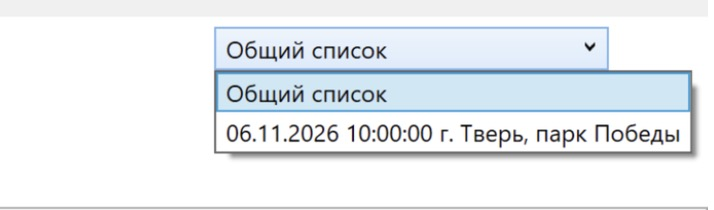
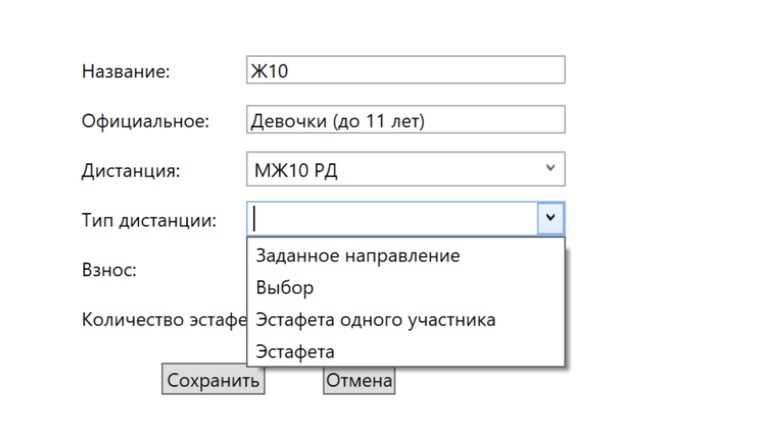

Импорт участников и дистанций
=============================

Импорт участников (CSV)
-----------------------

1. Скачиваем с orgeo.ru список участников в формате ``Excel CSV (кодировка Windows-1251)``.
   Формат файла подробно описан в разделе :ref:`format-csv`.

   .. image:: ../screens/orgeo_import.jpg

2. В программе открываем ``Файл -> Импорт -> Участники(CSV)``.

   .. image:: ../screens/import_form.jpg

   1. Выбираем скачанный файл.
   2. Открывается окно с данными. Колонки файла автоматически сопоставляются с полями
      программы по названию.

      .. image:: ../screens/import_settings.jpg

   3. Колонки, которые не распознались, сопоставляем вручную — в заголовке колонки выбираем
      нужное поле программы. Например, колонку «№ чипа» с полем «Номер чипа».

      .. image:: ../screens/column_set.jpg

      .. image:: ../screens/column_set_2.jpg

   4. Если в файле нет строки заголовков и первая строка — это уже участник, ставим галочку
      ``Записывать первую строку в базу``.
   5. Нажимаем ``Записать информацию``.

Что происходит при импорте:

* группы и команды, которых ещё нет в базе, создаются автоматически;
* для новой группы программа сама заполняет **официальное название** по коду группы
  (например, «Мужчины», «Юноши (до 15 лет)»). Оно нужно для официальных протоколов, его можно
  исправить в карточке группы;
* у команды сохраняются код и название региона, представитель (из колонки «Кем подана»);
* квалификация из файла приводится к принятому виду (I, II, III, Iю, IIю, IIIю, КМС, МС,
  МСМК, ЗМС, б/р).

Поля программы, доступные для сопоставления:

.. list-table::
   :header-rows: 1
   :widths: 35 65

   * - Поле программы
     - Комментарий
   * - Группа
     - Обязательное. Название группы (М21, Ж14, МЖ12 …)
   * - Фамилия, Имя, Отчество
     - Отчество — необязательно
   * - Команда
     - Коллектив участника
   * - Дата рождения / год рождения
     - Поддерживается полная дата рождения (ГГГГ-ММ-ДД) и просто год
   * - Квалификация
     - Спортивный разряд
   * - Номер чипа
     - Номер SFR-чипа или RFID-метки
   * - Аренда ЧИПа
     - Признак аренды чипа (значение «Свой» — свой чип)
   * - Номер участника
     - Нагрудный номер, если он уже присвоен
   * - Телефон
     -
   * - Код региона, Регион
     - Сохраняются у команды, используются в протоколах и при отправке субъектов на orgeo.ru
   * - Кем подана (представитель)
     - Представитель команды
   * - Номер заявки
     -
   * - Статус оплаты
     - Значение «Оплачено» отмечает участника как оплатившего заранее
   * - Дни участия
     - Номера дней через запятую (1,2). Пусто — участвует во всех днях

Импорт дистанций OCAD 8
-----------------------

.. warning::
   | Дистанции привязываются к соревновательному дню (сделано для удобства при проведении
     многодневок).
   | Поэтому **перед импортом дистанций нужно выбрать соревновательный день**.

1. Экспортируем из OCAD дистанции в текстовый формат (файл вида ``…ClassesV8.txt``,
   см. :ref:`format-ocad`).
2. В программе открываем ``Файл -> Импорт -> Дистанции версии OCAD8 (текст)`` и выбираем файл.

   .. image:: ../screens/distance_import.jpg

3. Программа создаёт дистанции с названием из файла, длиной и списком КП с расстояниями.

Подстановка дистанций в группы
------------------------------

``Подготовка к старту -> Подставить дистанции в группы`` автоматически назначает дистанции
группам выбранного дня по названию дистанции.

Название дистанции разбивается на части по пробелам, запятым, ``;``, ``/`` и ``+``. Каждая часть
сравнивается с названиями групп. Сокращения вида ``МЖ12`` понимаются как группы ``М12`` и ``Ж12``.

Например, дистанция ``Ж21 М18 М35`` будет подставлена группам Ж21, М18 и М35, а дистанция
``МЖ12`` — группам М12 и Ж12.

* Обрабатываются только группы, у которых дистанция на этот день ещё не задана.
* Если группе подходит несколько дистанций, программа покажет их список — назначьте
  дистанцию вручную.
* В конце программа покажет, каким группам дистанции подставлены, и какие группы остались
  без дистанции.

Дистанцию можно назначить и вручную в карточке группы (см. :doc:`groups`).

