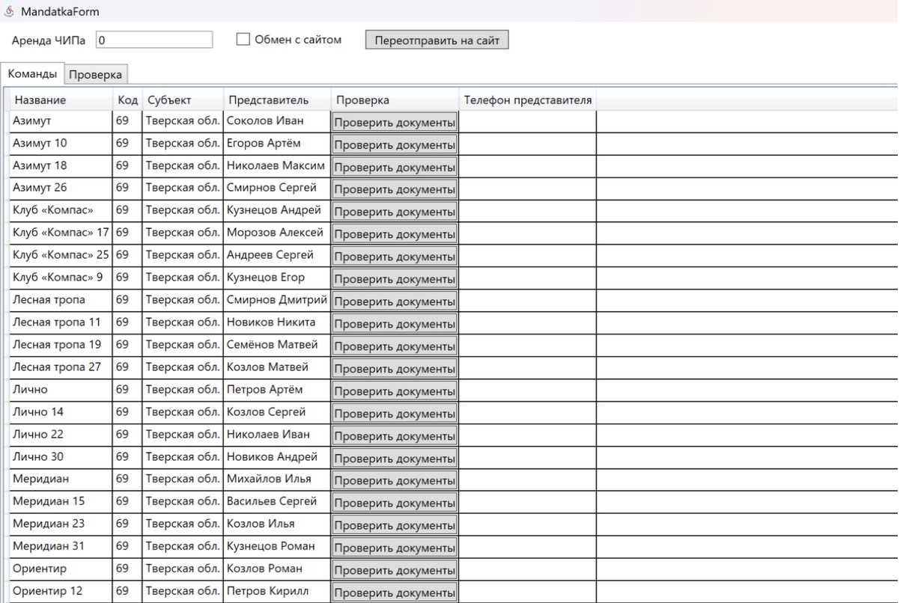
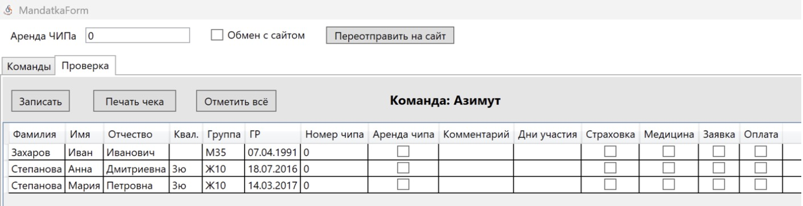

Мандатная комиссия
==================

``Подготовка к старту -> Мандатная комиссия`` открывает окно мандатной комиссии (заголовок окна
«MandatkaForm»): проверка документов и оплаты по командам.

Вверху окна:

* **Аренда ЧИПа** — стоимость аренды чипа за день; используется в чеке (``Печать чека``);
* галочка **Обмен с сайтом** и кнопка ``Переотправить на сайт`` — отправка списка участников
  команды (ФИО, группа, квалификация, дни, аренда, чип, команда, дата рождения) на локальный
  сервис ``http://127.0.0.1:5000``. Отметки мандатной комиссии не отправляются, обратно данные
  не приходят.

Вкладка «Команды»
-----------------

Список команд: Название, Код, Субъект, Представитель, Телефон представителя. Кнопка
``Проверить документы`` в строке команды открывает вкладку «Проверка» с участниками этой
команды. Двойной клик открывает карточку команды, в контекстном меню —
``Добавить команду`` / ``Удалить команду``.

Вкладка «Проверка»
------------------

Участники выбранной команды: Фамилия, Имя, Отчество, Квал., Группа, ГР, Номер чипа, Аренда
чипа, Комментарий, Дни участия и отметки:

* **Страховка**;
* **Медицина** (медицинский допуск);
* **Заявка**;
* **Оплата**.

В таблице меняются только отметки Страховка, Медицина, Заявка и Оплата. Остальные данные
(номер чипа, квалификация, дни участия) правятся в карточке участника — двойной клик по
строке. В контекстном меню — ``Добавить участника`` / ``Удалить участника``.

Кнопки:

* ``Записать`` — сохранить изменения и вернуться на вкладку «Команды»;
* ``Печать чека`` — напечатать чек на чековом принтере (при первом нажатии программа
  спросит принтер). На чеке: дни участия, аренда, взнос (0 у отмеченных «Оплата»),
  «Итого взнос», «Арендованных чипов». Аренда считается за каждый день участия;
* ``Отметить всё`` — поставить все отметки сразу.

Оплата
------

**Оплата** в мандатной комиссии — простая отметка, способ оплаты не спрашивается. Способ
(наличными или картой) выбирается при регистрации на старте (см. :doc:`start`), а итоги дня
показывает кнопка ``Посчитать`` главного окна.

Сумма в чеке считается по стартовым взносам групп на дни участия и аренде чипов.

Документы мандатной комиссии
----------------------------

В окне печати документов (см. :doc:`documents`) доступны:

* **Справка мандатной комиссии** — таблица «команда × группа» с числом заявленных и таблица
  «Справка о квалификации» (разряды по группам);
* **Должники мандатной** — участники, у которых не отмечены страховка, медицина, заявка или
  оплата.
