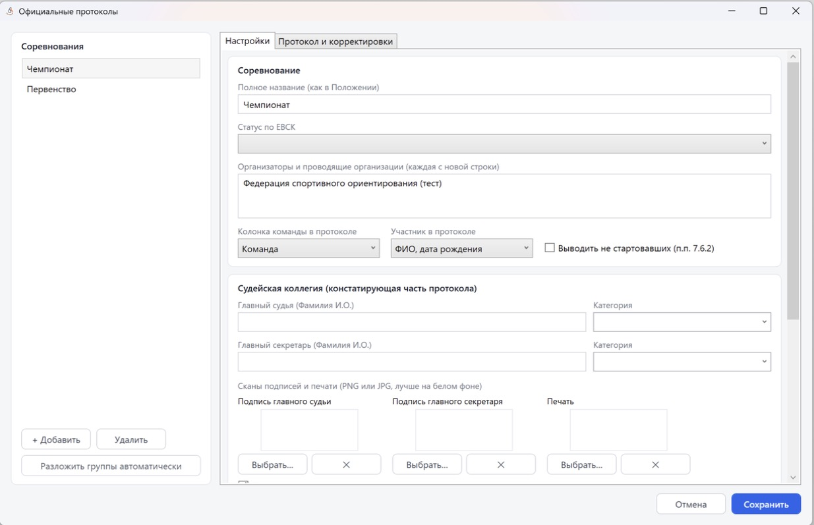
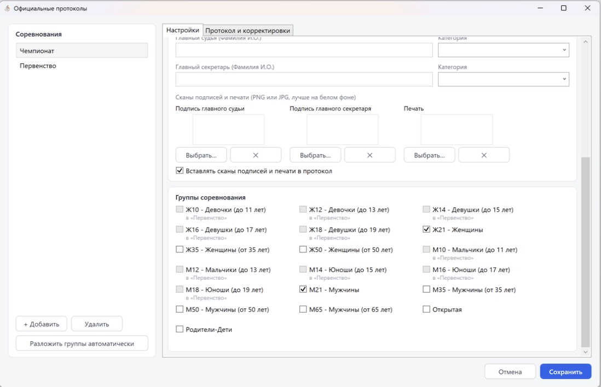
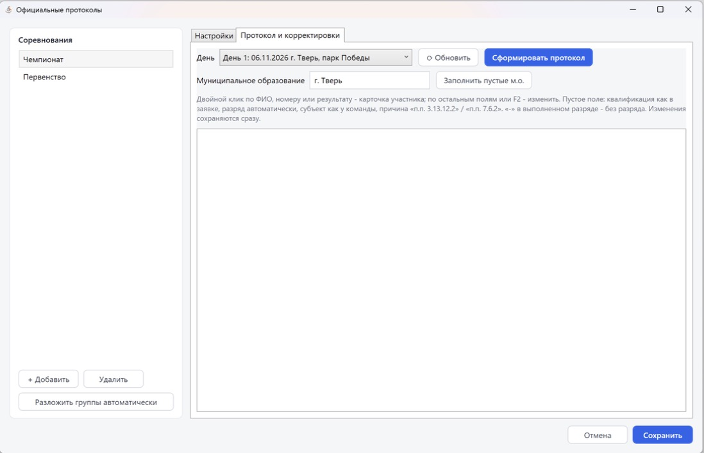

Официальные протоколы
=====================

``Файл -> Сформировать официальные протоколы`` открывает форму официальных протоколов
результатов по требованиям ЕВСК: с полным ФИО, датой рождения, субъектом РФ, квалификацией и
выполненными разрядами.

Соревнования
------------

В одном файле можно вести несколько официальных соревнований (например, чемпионат и
первенство). Кнопки ``+ Добавить`` и ``Удалить``.

``Разложить группы автоматически`` — распределяет группы по уже созданным соревнованиям, в
названии которых есть «Чемпионат» или «Первенство» (или с подходящим статусом); новые
соревнования не создаются, если группы уже распределены — программа спросит подтверждение.
Группы распределяются по официальным названиям:
«Мужчины/Женщины» — чемпионат, «до N лет» — первенство; ветераны и «Открытая» остаются без
протокола. Для этого у групп должно быть заполнено поле «Официальное название».

Параметры соревнования задаются на вкладке **Настройки**:

* **Полное название** (как в Положении);
* **Статус по ЕВСК** — уровень соревнований (международные, всероссийские, межрегиональные,
  субъекта РФ, муниципальные) с выбором конкретного вида (чемпионат России, первенство субъекта
  РФ и т.д.);
* **Организаторы и проводящие организации** — каждая с новой строки;
* **Колонка команды** — Команда, Муниципальное образование или Субъект РФ;
* **Участник в протоколе** — «ФИО, дата рождения» или «Фамилия, имя, год рождения»;
* **Выводить не стартовавших** (п.п. 7.6.2);
* **Судейская коллегия (констатирующая часть протокола)** — «Главный судья (Фамилия И.О.)»,
  «Главный секретарь (Фамилия И.О.)» и их **Категория** (ССВК, СС1К, СС2К, СС3К, ЮСС);
* сканы «Подпись главного судьи», «Подпись главного секретаря», «Печать» (кнопки ``Выбрать…``
  и ``✕``; PNG или JPG, лучше на белом фоне) и галочка
  ``Вставлять сканы подписей и печати в протокол``.

Настройки сохраняются кнопкой ``Сохранить`` (и автоматически перед формированием протокола),
``Отмена`` их отменяет.

Группы соревнования
-------------------

В конце вкладки **Настройки**, в блоке **Группы соревнования**, отмечаются группы, входящие в
это соревнование. Группы, которые уже входят в другое соревнование, недоступны и подписаны,
например, «в «Первенство»».

Протокол и корректировки
------------------------

Вверху вкладки выбирается **День**, кнопка ``⟳ Обновить`` перечитывает данные. Поле
**Муниципальное образование** (по умолчанию «г. Тверь») — значение, которое кнопка
``Заполнить пустые м.о.`` подставляет в пустые м.о. Само по себе в протокол оно не попадает.

Таблица участников для проверки перед печатью: Место, Номер, Участник, Дата рожд., Субъект РФ,
М.о., Квал. в заявке, Квал. для протокола, Результат, % от поб., Вып. разряд, Причина снятия /
н.с.

* Двойной клик по ФИО, номеру или результату — карточка участника; по остальным полям или
  **F2** — изменить значение.
* Пустое поле означает значение по умолчанию: квалификация — как в заявке, разряд —
  автоматически, субъект — как у команды, причина — «п.п. 3.13.12.2» / «п.п. 7.6.2».
* ``-`` в выполненном разряде — без разряда.
* ``Заполнить пустые м.о.`` — заполнить пустые муниципальные образования.
* Корректировки в таблице сохраняются сразу.

Нажмите ``Сформировать протокол``. Имя файла по умолчанию: «Протокол результатов - <название> -
день N.html».

Расчёт разрядов
---------------

Программа рассчитывает квалификационный уровень соревнований и выполненные разряды
автоматически. В протоколе выводится, были ли выполнены нормы, и почему, если нет:

* разряды не определяются, если не выбран статус соревнований, и в эстафетах (если дисциплина
  дня содержит слово «эстафета»);
* нормы не выполняются, если участвовало и закончило трассу в контрольное время меньше
  10 и 6 человек соответственно, или квалификационный уровень ниже 5 баллов;
* МС и КМС не присваиваются, если субъектов РФ меньше 23 — для статусов, где этого требуют
  правила;
* норма I разряда не присваивается на муниципальных соревнованиях; юношеские разряды — только
  если есть участники до 18 лет;
* «в контрольное время» берётся из контрольного времени дистанции, которое в текущей сборке
  нельзя задать из интерфейса.
