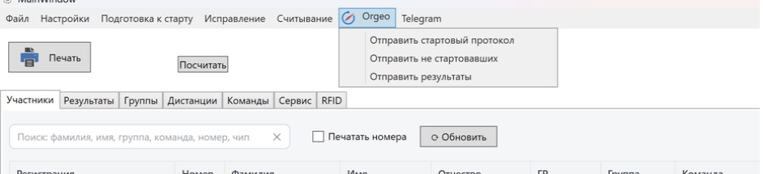

Orgeo.ru и онлайн-результаты
============================

Ссылки для отправки
-------------------

Ссылки для отправки данных берутся в кабинете организатора на orgeo.ru и вставляются в
``Настройки -> Информация`` в таблицу дней:

* **Онлайн (Orgeo)** — ссылка для стартового протокола и результатов дня;
* **Сумма дней (Orgeo)** — ссылка для суммы дней.

Если ссылка не указана, программа сообщит «Не указана ссылка для отправки онлайн-результатов!».

Меню Orgeo
----------

* **Отправить стартовый протокол** — отправит стартовый протокол на выбранный день (в поле
  номера чипа уходит нагрудный номер). Со 2-го дня, если указана ссылка суммы, протокол
  отправляется и туда;
* **Отправить не стартовавших** — отправит участников, которые не прошли регистрацию на
  старте;
* **Отправить результаты** — отправит все результаты на выбранный день. Со 2-го дня
  автоматически отправляется и сумма дней по ссылке «Сумма дней (Orgeo)».

Онлайн-результаты
-----------------

Галочка ``Онлайн результаты`` на вкладке «Результаты» включает автоматическую отправку каждого
нового результата на orgeo.ru (и при правке результата в карточке). Колонка «Онлайн»
показывает, отправлен ли результат.

Настройки обмена (``Настройки -> Настройки программы``):

* вкладка **Общие**: **Использовать GZIP для онлайна** — сжатие отправляемых данных (сохраняется
  сразу); **Отправлять в оргео субъекты, а не команды** — вместо команды на сайте выводится
  субъект РФ;
* вкладка **RFID**: **Отправка orgeo по кругам(rfid)** — отправка всех RFID-отсечек (см.
  :doc:`results`).

Все запросы к orgeo.ru и ответы сайта пишутся в ``Logs/orgeo-ГГГГ-ММ-ДД.log``. Если отправка
не проходит, программа покажет ответ сайта и сообщение «Не удалось отправить данные,
попробуйте очистить данные на orgeo.ru!» — очистите данные в кабинете orgeo.ru и отправьте
заново вручную. При сетевой ошибке — «ORGEO.RU: не удалось отправить данные».

Telegram
--------

Через меню ``Telegram -> Отправить результаты`` каждому участнику выбранного дня, у которого
есть результат и телефон (10–11 цифр, 8 заменяется на 7), уходит личное сообщение в Telegram.
В
``Настройки -> Настройки программы -> Общие`` укажите:

* **ТГ Ключ** — токен бота;
* **Текст сообщения** — шаблон, в котором можно использовать подстановки ``<Время>``,
  ``<Группа>``, ``<Мероприятие>``. ``<Время>`` — результат ЧЧ:ММ:СС или «снят».

.. note::
   Сообщения отправляются через внешний сервер ``176.108.245.200``: на него передаются ключ
   бота, телефоны участников и тексты сообщений.
