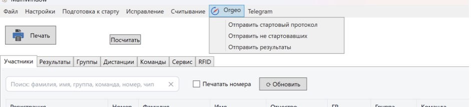

Orgeo.ru, портал и онлайн-результаты
====================================

Стартовые протоколы и результаты программа отправляет на **orgeo.ru**, на **свой портал** или
сразу в оба места.

Ссылки для отправки
-------------------

Ссылки вставляются в ``Настройки -> Информация`` в таблицу дней (у каждого дня свои):

* **Онлайн (Orgeo)** — ссылка для стартового протокола и результатов дня из кабинета
  организатора на orgeo.ru;
* **Сумма дней (Orgeo)** — ссылка для суммы дней на orgeo.ru;
* **Онлайн (портал)** — ссылка трансляции на портале: в карточке соревнования на портале блок
  «Онлайн-трансляция результатов» → ``Включить трансляцию`` → «Ссылка для программы».

Куда отправлять
---------------

``Настройки -> Настройки программы -> Общие`` → **Онлайн отправлять**:

* **на Orgeo** — как раньше (по умолчанию);
* **на портал**;
* **на Orgeo и на портал** — каждая отправка уходит по обеим ссылкам дня.

Настройка действует на все отправки из меню Orgeo и на онлайн-отправку результатов. Сумма дней
всегда уходит только на orgeo.ru. Если ссылки для выбранного места у дня нет, программа
сообщит «Не указана ссылка для отправки онлайн-результатов!».

Меню Orgeo
----------

* **Отправить стартовый протокол** — отправит стартовый протокол на выбранный день (в поле
  номера чипа уходит нагрудный номер). Со 2-го дня, если указана ссылка суммы, протокол
  отправляется и туда;
* **Отправить не стартовавших** — отправит участников, которые не прошли регистрацию на
  старте;
* **Отправить результаты** — отправит все результаты на выбранный день. Со 2-го дня
  автоматически отправляется и сумма дней по ссылке «Сумма дней (Orgeo)».

Онлайн-результаты
-----------------

Галочка ``Онлайн результаты`` на вкладке «Результаты» включает автоматическую отправку каждого
нового результата (и при правке результата в карточке) туда, куда выбрано в «Онлайн
отправлять». Колонка «Онлайн» показывает, отправлен ли результат; при отправке в оба места она
отмечается по ответу orgeo.ru. На вкладке RFID видно время последней отправки: «Онлайн:
отправлено ЧЧ:ММ:СС» или «Онлайн: ОШИБКА».

Настройки обмена (``Настройки -> Настройки программы``):

* вкладка **Общие**: **Использовать GZIP для онлайна** — сжатие отправляемых данных (сохраняется
  сразу); **Отправлять в оргео субъекты, а не команды** — вместо команды на сайте выводится
  субъект РФ;
* вкладка **RFID**: **Отправка orgeo по кругам(rfid)** — отправка всех RFID-отсечек (см.
  :doc:`results`).

Все запросы и ответы сайтов пишутся в ``Logs/orgeo-ГГГГ-ММ-ДД.log``. Окна с ответом
подписаны, откуда он пришёл: «ORGEO.RU: …» или «ПОРТАЛ: …». Если orgeo.ru не принял данные,
программа покажет ответ сайта и сообщение «ORGEO.RU: не удалось отправить данные, попробуйте
очистить данные на orgeo.ru!» — очистите данные в кабинете orgeo.ru и отправьте заново
вручную. При сетевой ошибке — «ORGEO.RU: не удалось отправить данные» (или «ПОРТАЛ: …»).

Онлайн на портале
-----------------

Трансляция на портале открывается по адресу соревнования с ``/live`` на конце. Табло
обновляется само раз в 5 секунд и работает на телефоне. Режим табло выбирается на портале в
карточке соревнования, в настройках трансляции:

* **Ориентирование** — у каждого участника можно открыть **распечатку**: время и место на
  каждом перегоне и от старта, потеря к лучшему, темп, пропущенные КП. Кнопка **Сплиты**
  открывает таблицу сплитов всей группы;
* **Забег** — карточки участников с **темпом** (мин/км) и **скоростью** (км/ч), полосой
  отсечек и временами на промежуточных точках. Для тех, кто ещё на дистанции, видно, где они
  сейчас по последней отсечке.

По умолчанию режим определяется по дисциплине соревнования (бег, марафон, трейл — «Забег»).

**Дистанции** портал получает только из программы: вместе со **стартовым протоколом** на
портал уходят дистанции групп — длина, КП по порядку с длинами перегонов (для распечатки) и
промежуточные точки RFID (для темпа по отрезкам). На orgeo.ru они не отправляются. После
правки дистанции отправьте стартовый протокол ещё раз. В карточке на портале блок «Дистанции
групп» показывает, что пришло.

Промежуточные точки берутся из вкладки **RFID** дистанции (см. :doc:`groups`):

* точки идут по порядку колонки **От старта, м**, название точки — из колонки «Название»;
* если у точки «Макс. считываний» больше 1, это круги: «Круг 1», «Круг 2», …, длина круга =
  длина дистанции / число кругов;
* последняя точка без расстояния считается финишем;
* если расстояния не заданы, программа делит дистанцию на равные круги по числу считываний.

Отсечки на портал идут, только когда включена **Отправка orgeo по кругам(rfid)** (``Настройки
-> Настройки программы -> RFID``): тогда уходят все считки метки, а не только итог. Если у
группы N промежуточных точек, первые N считок после старта — отсечки, следующая — финиш.

Telegram
--------

Через меню ``Telegram -> Отправить результаты`` каждому участнику выбранного дня, у которого
есть результат и телефон (10–11 цифр, 8 заменяется на 7), уходит личное сообщение в Telegram.
В
``Настройки -> Настройки программы -> Общие`` укажите:

* **ТГ Ключ** — токен бота;
* **Текст сообщения** — шаблон, в котором можно использовать подстановки ``<Время>``,
  ``<Группа>``, ``<Мероприятие>``. ``<Время>`` — результат ЧЧ:ММ:СС или «снят».

.. note::
   Сообщения отправляются через внешний сервер ``176.108.245.200``: на него передаются ключ
   бота, телефоны участников и тексты сообщений.
