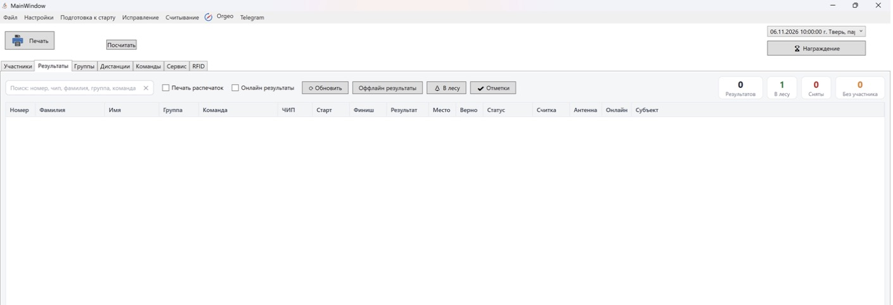
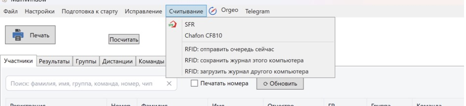

Результаты и считывание
=======================

Вкладка «Результаты»
--------------------

Показывает результаты выбранного дня.

* **Поиск** — по номеру, чипу, фамилии, группе, команде.
* Счётчики: **Результатов**, **В лесу**, **Сняты**, **Без участника**.
* Колонки: Номер, Фамилия, Имя, Группа, Команда, ЧИП, Старт, Финиш, Результат, Место, Верно
  (отметка верна), Статус, Считка, Антенна, Онлайн (отправлен ли результат на orgeo.ru),
  Субъект.

Кнопки ``В лесу`` и ``Отметки`` открывают панели:

* **В лесу** — список тех, кто отмечен на регистрации и ещё не финишировал;
* **Отметки** — отметки выделенного результата против КП дистанции: какие КП взяты, какие не
  взяты, какие лишние.

Контекстное меню таблицы (правая кнопка мыши):

* ``Печать сплита`` (**F2**) — печать сплита выделенного результата;
* ``Добавить результат`` (**Insert**) — создаёт пустую считку без участника со стартом 00:00:00
  и финишем, равным текущему времени; затем откройте её и заполните;
* ``Удалить результат``.

Над таблицей:

* галочка ``Печать распечаток`` — автоматически печатать сплит при каждой считке;
* галочка ``Онлайн результаты`` — автоматически отправлять результаты на orgeo.ru;
* ``⟳ Обновить`` — перечитать данные всех вкладок из базы;
* ``Оффлайн результаты`` — окно «Результаты» с таблицей, которую можно показать на экране в
  финишном городке (обновляется само раз в 60 секунд);
* статус RFID: «RFID: в очереди N».

Награждение открывается кнопкой ``🏆 Награждение`` главного окна (см. :doc:`documents`).

Карточка результата
~~~~~~~~~~~~~~~~~~~

Двойной клик или ``Enter`` по результату открывает карточку:

* номер участника (пустой номер — результат без участника, т.е. неопознанная считка);
* время старта и финиша (ЧЧ:ММ:СС), кнопка ``Старт из протокола``;
* статус: **Ок**, **Восстановлен**, **Снят**, **Дисквалифицирован**;
* считка: ЧИП, Антенна, Время считки;
* таблица отметок: №, Должен (КП по дистанции), Отметка, Время, Перегон.

Кнопки ``Сохранить`` (``Enter``) и ``Отмена`` (``Esc``). Если у участника уже есть результат, программа
предупредит — лишний результат удалите на вкладке «Результаты».

Исправления
~~~~~~~~~~~

* ``Исправление -> Перепроверить результаты`` — заново проверить отметки всех результатов дня
  (например, после правки дистанции).
* ``Исправление -> Свернуть отсечки (rfid) в один результат`` — объединить несколько отсечек
  RFID одного участника в один результат: остаётся самая ранняя запись, финишем становится
  последняя отсечка, промежуточные записываются в отметки как круги.
* На вкладке «Сервис» есть галочка **За не взятый КП начислять штраф 5 мин** (временная,
  потом переедет в настройки): к результату добавляется 5 минут за каждый не взятый КП,
  статус остаётся «Ок».

Считывание SFR
--------------

1. Подключите станцию SFR и включите ``Считывание -> SFR``.
2. Участник кладёт чип на станцию — программа считывает номер и отметки, находит участника по
   номеру из чипа, проверяет отметку и записывает результат.
3. Если номер из чипа не найден в стартовом протоколе или у участника уже есть результат,
   откроется окно **«Считка SFR - проверка»** (чип, номер в чипе, старт, финиш, результат,
   отметки и сплиты):

   * в поле **Записать на номер** укажите номер (можно исправить) и нажмите ``Записать``;
   * ``Не записывать``;
   * пустой номер — записать результат без участника (неопознанная считка), участника можно
     назначить позже в карточке результата.

   ``Enter`` — записать, ``Esc`` — не записывать.

Если в чипе нет времени старта, оно берётся из стартового протокола. У эстафет старт этапа
берётся из финиша предыдущего этапа.

RFID (UHF-метки, Chafon CF810)
------------------------------

Программа поддерживает UHF RFID-считыватель **Chafon CF810** — для хронометража на финише и
промежуточных точках (например, круги в триатлоне или массовых стартах).

Настройка
~~~~~~~~~

1. В ``Настройки -> Настройки программы`` на вкладке **RFID** укажите **COM-порт для RFID** и
   **номер текущей антенны** (точки; ``0`` — точка равна номеру антенны считывателя).
   **Номер финишной антенны** нужен только для отправки на orgeo.ru по кругам.
2. В дистанции задайте **Точек считывания**, **Считываний** и **Мин. время дистанции**, при
   необходимости — **Лимиты считываний по точкам** (см. :doc:`groups`).
3. Номер чипа участника — это номер его RFID-метки.
4. Включите ``Считывание -> Chafon CF810``.

Вкладка RFID
~~~~~~~~~~~~

Пока считыватель не включён, на вкладке написано «Включите считыватель: Считывание → Chafon
CF810».

Вверху вкладки: «Точка N», связь с базой, статус orgeo, «Считано X из Y», фильтр групп («Все
группы») и галочка **Только отмеченные на регистрации** (фильтрует список «Не считаны» и
счётчик).

* **Последние считки** — Время, Метка, Номер, Участник, Группа, Источник (RFID / Вручную),
  Статус (Отправлено / Без номера / В очереди / Ошибка). Неизвестные метки тоже принимаются —
  без номера.
* **Не считаны** — кто ещё не прошёл точку.
* **Отклонённые** — считки, которые не приняты, с причиной:

  * «Точка не входит в дистанцию участника»;
  * «Лимит считываний на точке исчерпан (N)»;
  * «Раньше, чем старт + мин. время (ЧЧ:ММ:СС)».

  Кроме того, повторная считка той же метки на точке раньше, чем через минимальное время
  дистанции, молча игнорируется.

* **Ручная отсечка** (поля «Номер», «Время», кнопка ``Сохранить``) — если метка не считалась:
  ``Insert`` — новая отсечка, номер + ``Enter`` — сохранить, ``Esc`` — оставить без номера. Отсечку, уже отправленную в базу, исправляйте на
  вкладке «Результаты».

Несколько компьютеров и журнал
~~~~~~~~~~~~~~~~~~~~~~~~~~~~~~

Каждая считка сначала записывается в **локальный журнал** компьютера
(``%APPDATA%\BelovSportProgram\rfid-journal.sqlite``), а затем отправляется в файл
соревнований. Вверху вкладки RFID показывается статус: «Связь с базой есть · в очереди N ·
ошибок N · без номера N».

* ``Считывание -> RFID: отправить очередь сейчас`` — отправить накопившиеся считки.
* ``RFID: сохранить журнал этого компьютера`` — сохранить журнал в файл
  ``rfid-journal_<ИмяКомпьютера>_ГГГГММДД_ЧЧММ.sqlite``.
* ``RFID: загрузить журнал другого компьютера`` — загрузить журнал с другой точки в текущую
  базу. Программа покажет, сколько считок за день в журнале и сколько из них новых; уже
  имеющиеся в базе считки не дублируются.

При включённой настройке **Отправка orgeo по кругам(rfid)** и онлайн-отправка, и «Отправить
результаты» отправляют на orgeo.ru вместо обычных результатов все считки метки; последняя
помечается номером финишной антенны.
