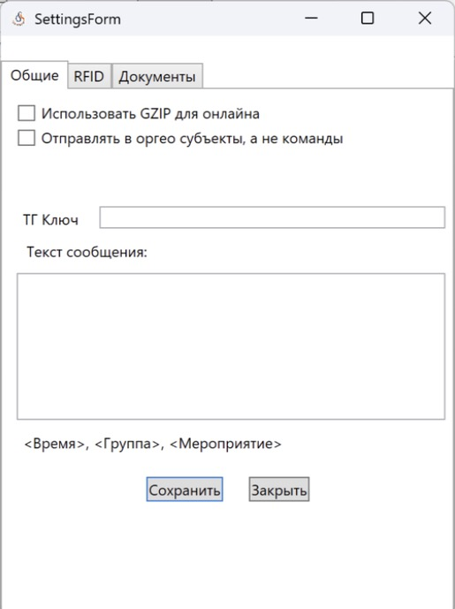
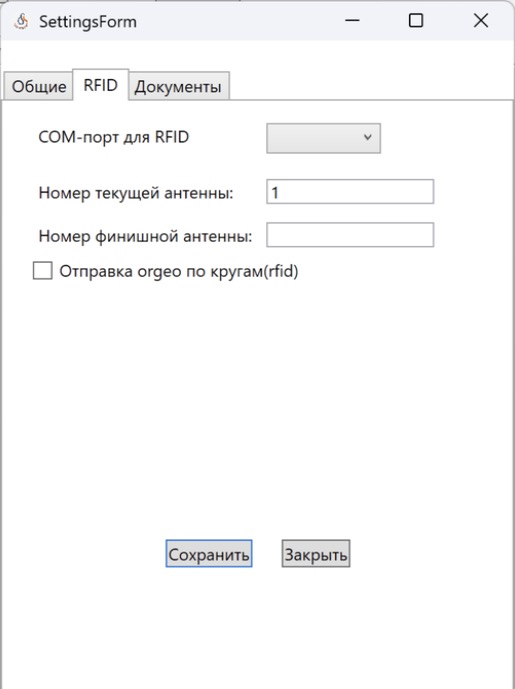
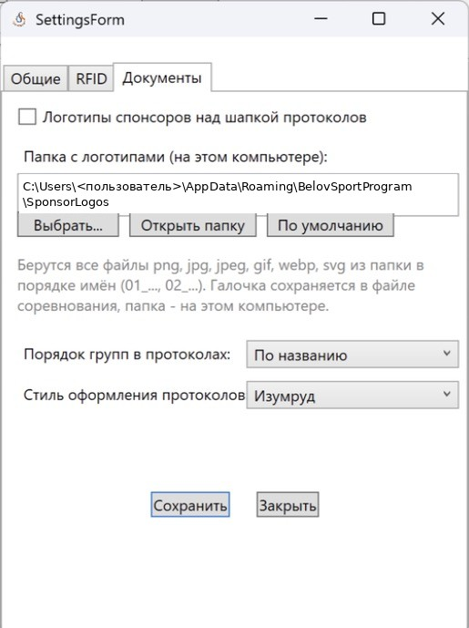

Настройки программы
===================

``Настройки -> Настройки программы``. Окно состоит из вкладок **Общие**, **RFID** и
**Документы**. Настройки этого компьютера хранятся в ``local-settings.json`` рядом с программой,
часть настроек — в файле соревнования.

Общие и RFID
------------

.. list-table::
   :header-rows: 1
   :widths: 40 60

   * - Настройка
     - Описание
   * - Использовать GZIP для онлайна
     - Сжимать данные при отправке на orgeo.ru
   * - ТГ Ключ, Текст сообщения
     - Отправка в Telegram (см. :doc:`orgeo`)
   * - Отправлять в оргео субъекты, а не команды
     - На orgeo.ru вместо команды выводится субъект РФ
   * - *Вкладка RFID:* COM-порт для RFID
     - Порт считывателя Chafon CF810
   * - Номер текущей антенны
     - Номер точки, на которой стоит этот компьютер
   * - Номер финишной антенны
     - Номер точки, которая считается финишем
   * - Отправка orgeo по кругам (rfid)
     - Отправлять промежуточные RFID-отсечки на orgeo.ru

Документы
---------

.. list-table::
   :header-rows: 1
   :widths: 40 60

   * - Настройка
     - Описание
   * - Логотипы спонсоров над шапкой протоколов
     - Папка с логотипами на этом компьютере (``Выбрать...``, ``Открыть папку``,
       ``По умолчанию``)
   * - Порядок групп в протоколах
     - По названию / По возрасту / В порядке создания
   * - Стиль оформления протоколов
     - Изумруд, Оранжевый, Синий с оранжевым, Синий, Бордо, Фиолетовый, Строгий

Пункты меню «Настройки»
-----------------------

* **Информация** — сведения о соревнованиях и днях (см. :doc:`competition`);
* **Упрощённая регистрация** — упрощённый режим регистрации на старте;
* **Присваивать номер чипа при регистрации** — при регистрации запрашивается номер чипа.

Горячие клавиши
---------------

.. list-table::
   :header-rows: 1
   :widths: 25 75

   * - Клавиша
     - Действие
   * - Enter
     - Поиск / сохранить
   * - Esc
     - Очистить поиск / отмена
   * - F2
     - «Участники»: зарегистрировать / отменить. «Результаты»: печать сплита
   * - F3
     - Записать номер в чип SFR
   * - Insert
     - Добавить результат; новая ручная отсечка RFID
   * - Delete
     - Жеребьёвка: убрать группу из коридора
   * - N / B
     - Оплата наличными / картой
