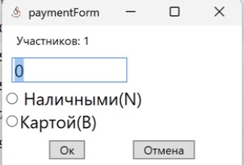
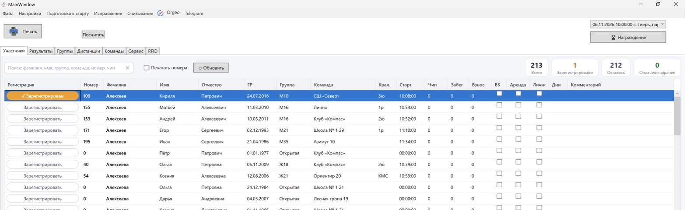
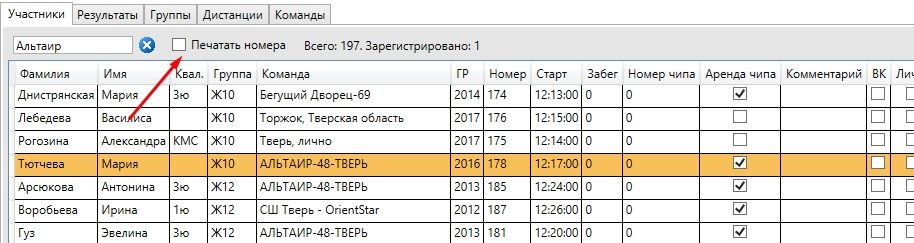
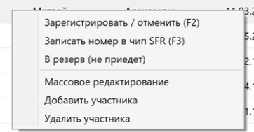
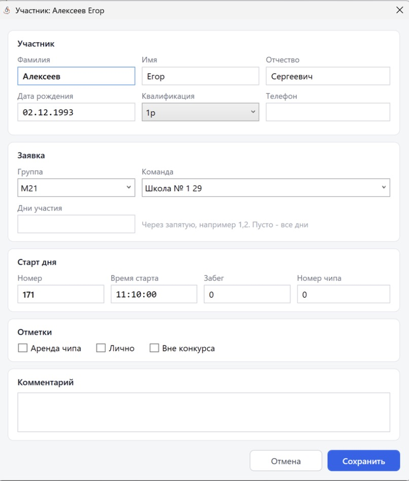
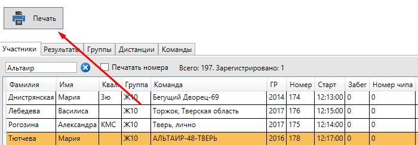

На старте: вкладка «Участники»
==============================

1. Выберите нужный соревновательный день.

2. Поиск участников работает по полям: **фамилия, имя, группа, команда, номер, чип**.
   Поиск срабатывает сам через долю секунды после ввода; ``Enter`` применяет его сразу и
   выделяет первую строку, ``Esc`` очищает поиск. Каждое слово ищется отдельно (например,
   ``иванов м21``), числа сравниваются с номером и чипом точно.

   .. image:: ../screens/finder.jpg

3. Вверху показываются счётчики: **Всего**, **Зарегистрировано**, **Осталось**,
   **Оплачено заранее**.

Колонки таблицы
---------------

Регистрация (кнопка), Номер, Фамилия, Имя, Отчество, ГР (дата рождения), Группа, Команда,
Квал., Старт, Чип, Забег, Взнос, ВК (вне конкурса), Аренда, Лично, Дни, Комментарий.

Рядом с поиском — галочка ``Печатать номера`` и кнопка ``⟳ Обновить``.

Регистрация
-----------

Кнопка ``Зарегистрировать`` в первой колонке (или клавиша **F2**) отмечает, что участник
пришёл на старт. Если участник ещё не оплатил участие, откроется окно оплаты с суммой (её можно
изменить): выберите ``Наличными(N)`` или ``Картой(B)`` и нажмите ``Ок`` (или Enter). У
оплативших заранее кнопка называется «Оплачено · зарегистрировать», окно оплаты не
открывается.

Можно выделить несколько участников и зарегистрировать их сразу — сумма делится между ними.
Участника без номера зарегистрировать нельзя: «Один или несколько участников не имеют
номера».

После регистрации кнопка становится оранжевой — «✓ Зарегистрирован», счётчики вверху
обновляются. Повторное нажатие отменяет регистрацию.

* ``Настройки -> Упрощённая регистрация`` — регистрация без окна оплаты. Взнос группы при этом
  записывается как оплата картой (это учитывается в ``Посчитать``).
* ``Настройки -> Присваивать номер чипа при регистрации`` — после оплаты откроется окно ввода
  номера чипа: введите номер и нажмите ``Сохранить`` (или Enter). Занятый номер программа не
  примет: «Номер чипа уже занят!».
* Участники, не нажавшие регистрацию, считаются **не стартовавшими** — их можно отправить на
  orgeo.ru (см. :doc:`orgeo`).

Печать номеров
--------------

Для печати номеров прямо на старте включите галочку ``Печатать номера`` и выберите принтер.
Номер будет печататься при регистрации участника.

* Шаблон номера — ``Templates/bib.html``, его можно изменить под свои соревнования. Внешний вид
  номера можно также настроить без правки HTML в :doc:`bib_designer`.
* При регистрации печатается одна копия номера. На номере: номер, ФИО, «Старт:», «Номер
  чипа:», «Группа:», «Коллектив: <код>_<команда>» и QR-код.
* В окне документов есть пункт **Распечатать номера по командам** — номера печатаются сразу на
  принтер, каждая команда отдельным заданием (удобно для принтера с отрезчиком). Для него
  действует настройка «Количество копий номера».

Запись номера в чип SFR
-----------------------

Пункт контекстного меню ``Записать номер в чип SFR`` (клавиша **F3**) на вкладке «Участники»
записывает нагрудный номер выбранного участника в чип SFR:

1. Подключите станцию SFR.
2. **Выключите считывание SFR** на время записи номеров — при включённом считывании программа
   запись не выполнит и предупредит об этом.
3. Положите чип на станцию и нажмите F3. Если в чипе уже есть данные (номер, отметки),
   программа предупредит, что они будут стёрты.
4. Не убирайте чип со станции, пока в строке статуса (рядом с ``⟳ Обновить``) не появится
   «✓ Номер N записан в чип (Фамилия Имя)». Другие сообщения там же: «Положите чип на станцию
   и нажмите F3 ещё раз», «Станция SFR не подключена».

Другие действия
---------------

Контекстное меню (правая кнопка мыши по участнику):

* ``Зарегистрировать / отменить`` (**F2**), ``Записать номер в чип SFR`` (**F3**);

* ``В резерв (не приедет)`` — участник становится резервным местом: фамилия станет «Резерв»,
  имя, отчество, команда, год рождения, телефон и квалификация очистятся, снимутся отметки
  (ВК, Лично, Аренда, Оплачено заранее, мандатной комиссии), регистрация и оплата. В
  комментарий запишется «Резерв: был <ФИО, команда>». Номер, группа и время старта останутся —
  их можно будет отдать другому участнику. Участника с результатом (в любом дне) перевести в
  резерв нельзя.
* ``Массовое редактирование`` — изменить время старта и забег сразу у нескольких участников
  (нужен выбранный день).
* ``Добавить участника`` / ``Удалить участника``. Участника с результатом удалить нельзя.
* Двойной клик открывает **карточку участника**.

Карточка участника
------------------

* **Участник**: Фамилия, Имя, Отчество, **Дата рождения** (ДД.ММ.ГГГГ, точки ставятся сами;
  пусто — дата неизвестна), Квалификация (выбор из списка: пусто, 3ю, 2ю, 1ю, 3р, 2р, 1р, КМС,
  МС, МСМК), Телефон.
* **Заявка**: Группа, Команда, **Дни участия** — через запятую, например ``1,2``. Пусто — все
  дни.
* **Старт дня** — **для выбранного дня** задаются Номер и Время старта (ЧЧ:ММ:СС, двоеточия
  ставятся сами); они сохраняются, только если номер не 0. **Забег** и **Номер чипа** общие
  для всех дней.
* **Отметки**: Аренда чипа, Лично, Вне конкурса.
* **Комментарий**.

Программа проверит, что номер не занят другим участником.

Печать документов
-----------------

Кнопка ``Печать`` на панели главного окна открывает окно формирования документов (см.
:doc:`documents`).

